# BrainCT-ICH: hemorrhage detection from whole head-CT series to a monitored Kubernetes API

[](https://github.com/NirmalKumar31/BrainCT-ICH-MLOps/actions/workflows/ci.yml)
[](LICENSE)

> **Research use only. Not a medical device. Not for diagnosis or any clinical decision.**

An end-to-end ML system that reads a whole non-contrast head CT series and reports, per slice
and per study, the probability of intracranial hemorrhage and its five subtypes. It covers the
whole path: data streamed straight from a 144 GB archive into an HU cache, a CNN plus a
series model trained on a laptop GPU, calibration and thresholds fit on validation, INT8 ONNX
export certified through the serving code, a PyTorch-free FastAPI service with heatmaps and
drift monitoring, and a Helm deployment that CI installs on a Kubernetes cluster on every push.

It is a from-scratch rebuild of
[BrainCT-Hemorrhage-MLOps](https://github.com/pratox1112/BrainCT-Hemorrhage-MLOps), aimed at
that project's stated limitations: single-slice input, no drift monitoring, deployment
verified by hand. All numbers come from [`docs/results.md`](docs/results.md); design choices
are in [`docs/decisions.md`](docs/decisions.md).

## Highlights

| | Result (held-out test: 266 patients, 315 series, 10,934 slices) |
|---|---|
| **Model quality, deployed INT8 chain** | macro ROC AUC **0.920** (95% CI 0.854–0.957, patient bootstrap); RSNA weighted log loss **0.123**; study-level AUC "any" **0.948** |
| **Series model vs single-slice CNN** | +0.018 macro AUC; subarachnoid 0.907 → **0.932**, subdural 0.916 → **0.939** (same CNN, same split) |
| **Calibrated outputs** | ECE ≤ 0.011 for every label; screening threshold: 97.0% slice sensitivity at 69.8% specificity |
| **INT8 vs FP32** | same macro AUC (0.920 vs 0.920); CNN 11.3 MB vs 44.7 MB; whole-series inference **257 ms** vs 809 ms (ONNX FP32) vs 1,223 ms (PyTorch), M4 CPU |
| **Serving matches evaluation** | 60 real series uploaded as shuffled DICOMs through Kubernetes: served probabilities equal the offline certified ones within **5e-6** |
| **Kubernetes** | HPA 1 → 3 pods in 31 s; ~3.1 series/s (~100 slices/s) on a 4-vCPU VM, 0 errors under 8 concurrent clients |
| **Drift** | input + prediction PSI per feature in Prometheus; out-of-distribution traffic drove PSI to 7–12 and raised the alert |
| **CI** | lint, types, 66 tests (94% coverage), image scan, container smoke test, **kind + Helm end-to-end** on every push |

How this compares with the reference project, plainly: its model reached test macro AUC 0.977
with a ResNet-50 trained on all 752,803 RSNA slices on an A100 cluster. This one trains a
ResNet-18 for 5 epochs on a **9.5%** sample (71,736 slices) on a laptop, so its absolute AUC is
lower, and the two test sets differ. The improvements are in what the system does: whole-series
input with a series model, calibrated probabilities and stated operating points, certification
of the exact deployed artifact, explainability, drift monitoring, and automated deployment tests.

## Architecture

```mermaid
flowchart LR
    subgraph Data["Data (laptop, 141 s)"]
        HF[(RSNA 16-bit PNG tar<br/>144 GB, Hugging Face)] -->|16 parallel HTTP ranges,<br/>tar resync| C[(HU cache<br/>int16, 224 px, 6.7 GB)]
        C --> S[patient split<br/>stratified by rarest subtype]
    end
    subgraph Train["Training (Apple M4 GPU, MLflow)"]
        S --> CNN[ResNet-18 slice CNN<br/>HU windowing in-graph]
        CNN -->|embeddings + logits| SEQ[BiGRU series model]
    end
    subgraph Export["Export + certification"]
        SEQ --> Q[ONNX + static INT8]
        Q --> CERT[deployed chain on val/test:<br/>Platt calibration, thresholds,<br/>CIs, drift reference, checksums]
    end
    subgraph Serve["Serving (no PyTorch)"]
        CERT --> API[FastAPI: series / slice<br/>CAM heatmaps, drift PSI]
        API --> K[Helm: HPA, PDB,<br/>NetworkPolicy, probes]
        K --> P[Prometheus alerts] --> G[Grafana]
    end
```



## The API

```bash
curl -F "files=@scan.zip" "http://127.0.0.1:8080/v1/predict/series?explain=true"
```

- `POST /v1/predict/series`: the DICOM slices of one series (several files or one zip).
  Slices are ordered by position along the slice normal and run through the CNN and the series
  model. Returns per-slice probabilities and positive labels, a study summary (hemorrhage
  yes/no at the validation F1 threshold, a high-sensitivity screening flag, subtypes, key
  slice), warnings (missing geometry, short series, 12-bit sign fix), and optionally a class
  activation heatmap of the key slice.
- `POST /v1/predict/slice`: one DICOM, CNN head only (separately calibrated).
- `GET /v1/model` (model card: contract, thresholds, test metrics), `GET /v1/drift`,
  `GET /metrics`, `GET /health`, `GET /ready`.

Rejects with a clear 4xx: non-CT modality, mixed series, oversized uploads, zip bombs,
undecodable files. Uploads are processed in memory and never stored; logs and responses
carry no DICOM tags.

## Repository layout

```
src/brainct/
  data/            streaming ingest from the tar (range requests, resync), patient split
  preprocessing/   DICOM -> HU (12-bit sign fix, slice geometry), pad + area resize
  training/        dataset, CNN + series model, train loops, MLflow tracking   (PyTorch)
  optimization/    ONNX export, INT8 quantization, certification, benchmark   (PyTorch)
  serving/         FastAPI app, ONNX Runtime inference, series assembly, settings
  monitoring/      drift features, reference histograms, PSI monitor
  evaluation.py    calibration, thresholds, patient-bootstrap CIs, ablation tables
  metrics.py       AUC / AP / log loss / ECE / Platt in numpy (no sklearn at serve time)
tests/             unit, API and release tests; synthetic DICOMs only
configs/           deployed run (single slice) and the 2.5D ablation
serving/           Dockerfile + requirements exported from uv.lock
infra/helm/        chart (HPA, PDB, NetworkPolicy, probes) + kind values
monitoring/        Prometheus (pod discovery, alert rules) + Grafana dashboard as code
load_tests/        Locust step load and an in-cluster load Job
scripts/           stand-in bundle, smoke test, real-series e2e, figures, load summary
docs/              results.md, decisions.md, benchmark.json, figures/
```

## Run it

Python 3.12 and [uv](https://docs.astral.sh/uv/). Data and trained weights are not in the
repository (see below); `make` targets run each stage.

```bash
make setup                 # uv sync, all extras
make lint test             # ruff, mypy, pytest

make data split            # stream ~2,000 RSNA series (~7 GB, ~2.5 min), patient split
make train seq             # CNN (~45 min on an M4), then the series model (~3 min, CPU)
make compare               # 2x2 ablation table (needs `make train-25d` for the 2.5D rows)
make export benchmark      # ONNX + INT8 + certification -> artifacts/bundle; latency
uv run pytest tests/regression   # release gates on the trained bundle

make image serve smoke     # Docker image; or run the API locally on :8000

make kind-up image deploy monitoring   # local Kubernetes + Prometheus + Grafana
kubectl port-forward svc/brainct-brainct 8080:80
uv run python scripts/e2e_real_series.py http://127.0.0.1:8080   # real series vs offline
kubectl create configmap brainct-load --from-file=load_tests/incluster.py \
    --from-file=tests/dicom_factory.py && kubectl apply -f load_tests/job.yaml
make kind-down
```

Without the data, `make standin image BUNDLE=artifacts/standin` builds the service with a
weights-free stand-in model that has the same interface; that is what CI deploys.

## Known limitations

- **Epidural is not usable.** 0.5% of slices; 24 training patients. Test AUC 0.759 with a CI
  of 0.37–0.95 (5 test patients), AP 0.014. It needs far more data or targeted sampling.
- **Small sample of one source.** 9.5% of RSNA 2019, one public dataset, no external
  validation. Lower absolute AUC than full-data models; differences in the ablation are
  smaller than their CIs (one seed each).
- **Series-model training embeddings are in-sample** (from the CNN trained on those slices);
  out-of-fold embeddings would likely help more. The gain was measured on held-out test.
- **CAM heatmaps come from the CNN**, not the series model, and show where the CNN looked,
  not a segmentation.
- **CPU-only serving**; throughput was measured on a 4-vCPU laptop VM, not a managed cluster.
  No managed-cloud deployment was run for this version.
- Drift thresholds (PSI > 0.2) are the conventional rule of thumb, not tuned on real shifts.

## Data and license

- Data: [RSNA Intracranial Hemorrhage Detection](https://www.kaggle.com/competitions/rsna-intracranial-hemorrhage-detection)
  (2019), via its [16-bit PNG release](https://huggingface.co/datasets/ianpan/rsna-intracranial-hemorrhage-16bit-png).
  Its terms apply. **No images, caches or trained weights are distributed here**; tests and CI
  use synthetic phantoms and a stand-in model.
- Code: [MIT](LICENSE).
- Reference project and the original 2025 notebooks: Pratosh Karthikeyan and Nirmal,
  [BrainCT-Hemorrhage-MLOps](https://github.com/pratox1112/BrainCT-Hemorrhage-MLOps).
