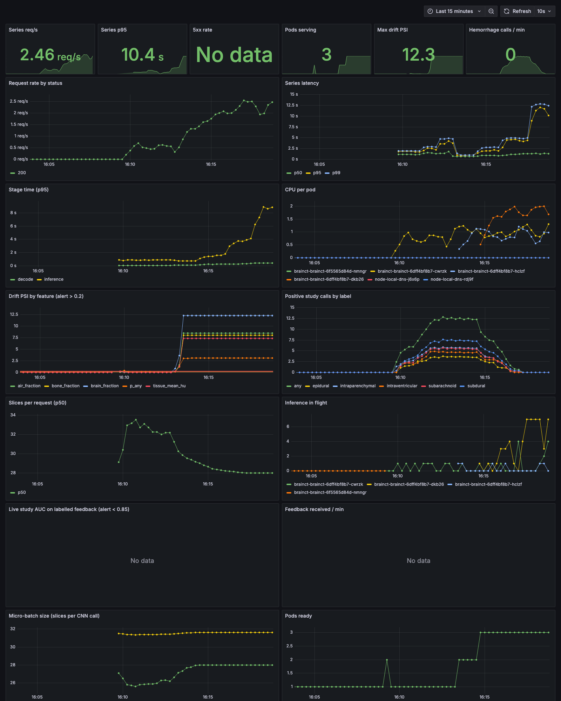
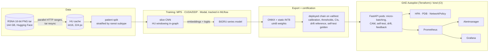

# BrainCT-ICH: hemorrhage detection from whole head-CT series to a monitored, autoscaled cloud API

[](https://github.com/NirmalKumar31/BrainCT-ICH-MLOps/actions/workflows/ci.yml)
[](LICENSE)

<p>
  
  
  
  
  
  
  
  <br>
  
  
  
  
  
  
</p>

> **Research use only. Not a medical device. Not for diagnosis or any clinical decision.**

An end-to-end ML system that reads a whole non-contrast head CT series and reports, per slice
and per study, the probability of intracranial hemorrhage and its five subtypes:

- **data** streamed straight from a 144 GB archive into an HU cache (parallel HTTP ranges);
- **training** on all 752,802 RSNA slices on a cloud A100 (Modal), on Apple MPS locally, and
  multi-GPU with DDP: a slice CNN plus a whole-series BiGRU, tracked in MLflow;
- **evaluation** with patient-level bootstrap CIs, a 2×2 ablation, calibration and operating
  points, all fit on validation;
- **INT8 ONNX** certified through the serving code, on two CPU architectures;
- a **PyTorch-free FastAPI** service with CAM heatmaps, cross-request micro-batching, a startup
  numerics self-test, drift monitoring and live quality monitoring from ground-truth feedback;
- **deployment** with Terraform to GKE Autopilot (Helm, HPA, PDB, NetworkPolicy), Prometheus,
  Alertmanager and Grafana, load-tested in-cluster; plus kind + Helm end-to-end in CI.

It is a from-scratch rebuild of
[BrainCT-Hemorrhage-MLOps](https://github.com/pratox1112/BrainCT-Hemorrhage-MLOps). Every number
comes from [`docs/results.md`](docs/results.md); proof (screenshots, logs, raw outputs) is in
[`docs/evidence/`](docs/evidence/README.md); design choices and an incident write-up are in
[`docs/decisions.md`](docs/decisions.md).

## Highlights

| | Result (held-out test: 2,841 patients, 3,231 series, 111,941 slices; all of RSNA) |
|---|---|
| **Deployed model** | ResNet-50 + series model, INT8: macro ROC AUC **0.981** (95% CI 0.978–0.984, patient bootstrap); RSNA weighted log loss **0.066**; study-level AUC "any" **0.978** |
| **Series model vs single-slice CNN** | 0.973 → **0.982** macro AUC (FP32), CIs do not overlap; subarachnoid 0.961 → **0.979**, subdural 0.961 → **0.974** |
| **Trained on a cloud GPU** | whole 144 GB archive ingested in 753 s; ResNet-50 at ~1,600 img/s on an A100 (Modal), ~30 min per model |
| **Calibrated, with operating points** | ECE ≤ 0.004 per label (slice level); screening: 95.3% sensitivity at 92.5% specificity |
| **INT8** | macro AUC 0.981 vs 0.982 FP32; 24 MB vs 94 MB; 32-slice series in **586 ms** vs 1,836 ms (FP32 ONNX) vs 5,792 ms (PyTorch) on an M4 |
| **Served = certified, across CPUs** | certified on x86, served on ARM: 60 real series through the API, mean \|Δp\| **0.00026**; on GKE (ResNet-18 bundle) **0.0009** |
| **Caught a cloud-only numerics bug** | INT8 diverged by 0.56 on GKE's AMD EPYC (no VNNI); fixed with uint8 weights + a per-pod startup self-test with FP32 fallback |
| **GKE autoscaling** | HPA 1 → 4 pods; 0 errors up to 16 concurrent clients; Terraform apply → test → destroy |
| **Monitoring that fired** | drift PSI and latency alerts fired and reached Alertmanager; live AUC 0.959 from 80 labelled studies via `/v1/feedback` |
| **CI** | lint, types, tests (94% coverage), Trivy, container smoke test, **kind + Helm e2e**, Terraform validate/tflint |



## Compared with the reference project

| | Reference (BrainCT-Hemorrhage-MLOps) | This repository |
|---|---|---|
| Model input | single slice | whole series (CNN + BiGRU series model); 2.5D tested |
| Training data | all 752,803 slices (A100, Slurm) | all 752,802 slices (A100, Modal, one command per stage); 9.5% sample on a laptop |
| Test macro AUC | 0.977 (ResNet-50, single slice) | **0.981** INT8 / **0.982** FP32 (ResNet-50 + series model, CI 0.979–0.984; different patient split) |
| Subtypes it calls weakest | subarachnoid, subdural | subarachnoid 0.979, subdural 0.974 |
| Probabilities | thresholds | Platt-calibrated, ECE reported, screening + study operating points |
| What is certified | exported model | the deployed chain, through the serving code, on ARM and x86 |
| Experiment tracking | Weights & Biases | MLflow |
| Multi-GPU | no | DDP (`torchrun`), verified with 2 processes |
| Serving | FastAPI, ONNX INT8, micro-batching | + series endpoint, CAM heatmaps, bundle checksums, numerics self-test with FP32 fallback |
| Drift monitoring | listed as missing | input + prediction PSI, alert |
| Quality monitoring | no | live AUC / Brier / ECE from delayed ground truth, alert |
| Alert routing | no | Alertmanager |
| Cloud | GKE Autopilot, Terraform, Helm, HPA | same, plus PDB, NetworkPolicy (Dataplane V2), least-privilege node SA |
| Deployment testing | manual | kind + Helm e2e in CI on every push; real-series e2e against certified outputs |

Both projects test on a patient-level split of all of RSNA, but not the same split, so the
comparison is not exact. Here the same single-slice ResNet-50 reaches 0.973 (CI 0.969–0.975);
the gain comes from the series model reading the whole scan.

## Architecture



## The API

```bash
curl -F "files=@scan.zip" "http://127.0.0.1:8080/v1/predict/series?explain=true"
curl -X POST http://127.0.0.1:8080/v1/feedback -H 'content-type: application/json' \
     -d '{"request_id": "<x-request-id of the prediction>", "labels": {"any": 1, "subdural": 1}}'
```

| Endpoint | |
|---|---|
| `POST /v1/predict/series` | DICOM slices of one series (files or a zip) → per-slice probabilities, study summary (hemorrhage at the validation F1 threshold, screening flag, subtypes, key slice), warnings, optional CAM heatmap |
| `POST /v1/predict/slice` | one DICOM, CNN head only (separately calibrated) |
| `POST /v1/feedback`, `GET /v1/performance` | delayed ground truth → live study-level AUC / Brier / ECE |
| `GET /v1/model`, `GET /v1/drift` | model card (metrics, thresholds, precision, self-test), drift state |
| `GET /metrics`, `/health`, `/ready` | Prometheus metrics; liveness; readiness (503 until the bundle is verified and loaded) |

Example response, heatmap and OpenAPI screenshot: [`docs/evidence/`](docs/evidence/README.md).

## Repository layout

```
src/brainct/
  data/            streaming ingest (range requests, tar resync), patient split
  preprocessing/   DICOM -> HU (12-bit sign fix, slice geometry), pad + area resize
  training/        dataset, CNN + series model, train loops (MPS/CUDA, DDP), MLflow
  optimization/    ONNX export, INT8, certification, self-test golden, benchmark
  serving/         FastAPI app, ONNX Runtime inference, micro-batcher, series assembly
  monitoring/      drift (PSI vs training reference), live performance from feedback
  evaluation.py    calibration, thresholds, patient-bootstrap CIs, ablation tables
  metrics.py       AUC / AP / log loss / ECE / Platt in numpy
cloud/             Modal GPU pipeline, Cloud Build config, cloud requirements
infra/terraform/   GKE Autopilot, Artifact Registry, node IAM
infra/helm/        chart (HPA, PDB, NetworkPolicy, probes) + kind and GKE values
monitoring/        Prometheus, alert rules, Alertmanager, Grafana dashboard (Kustomize)
load_tests/        in-cluster load Job (kind, GKE) and Locust
scripts/           stand-in bundle, smoke / real-series e2e, quantization study, evidence, figures
tests/             unit, API and release tests; synthetic DICOMs only
docs/              results, decisions (incl. incident), evidence/, figures/, benchmark.json
```

## Run it

Python 3.12 and [uv](https://docs.astral.sh/uv/). Data and trained weights are not in the
repository (see below).

```bash
make setup lint test                     # environment, ruff + mypy, pytest
make data split train seq compare        # stream RSNA sample, split, CNN, series model, ablation
make export benchmark                    # ONNX + INT8 + certification -> artifacts/bundle
uv run pytest tests/regression           # release gates on the trained bundle
make image serve smoke                   # Docker image / local API / smoke test

# multi-GPU
uv run torchrun --nproc_per_node 4 -m brainct.training.train_cnn --config configs/cnn2d_resnet18.yaml

# full RSNA on a cloud GPU (Modal)
modal run cloud/modal_pipeline.py::ingest
modal run cloud/modal_pipeline.py::train --config full_resnet50_2d
modal run cloud/modal_pipeline.py::finish --config full_resnet50_2d
modal volume get brainct-runs full_resnet50_2d/bundle artifacts/

# GKE (costs money while it runs)
terraform -chdir=infra/terraform apply
gcloud builds submit --config cloud/cloudbuild.yaml --substitutions=_IMAGE=<registry>/brainct-api:0.2.1 <context>
helm install brainct infra/helm/brainct -f infra/helm/brainct/values-gke.yaml --set image.repository=<registry>/brainct-api
kubectl apply -k monitoring
uv run python scripts/e2e_real_series.py http://127.0.0.1:8080 --tol 0.05 --feedback
terraform -chdir=infra/terraform destroy
```

Without the data, `make standin image BUNDLE=artifacts/standin` builds the service with a
weights-free stand-in model of the same interface; that is what CI deploys.

## Known limitations

- **Epidural stays weak:** AUC 0.969, but AP 0.30 and 40% sensitivity at the F1 threshold
  (500 test slices); it is the rarest subtype.
- **One source, one seed:** RSNA 2019 only, no external validation; each ablation arm was
  trained once.
- **Series-model training embeddings are in-sample** (from the CNN trained on those slices).
- **Study-level probabilities are not re-calibrated:** slice-level ECE ≤ 0.012, but the max over
  a series showed ECE 0.08–0.12 on 80 live-labelled studies.
- **Feedback is joined per pod:** predictions awaiting ground truth live in each pod's memory,
  so with several replicas feedback must reach the pod that served the request. A shared store
  (e.g. Redis) or an offline join from prediction logs is needed in production.
- **CAM heatmaps come from the CNN**, not the series model; they show attention, not a segmentation.
- **CPU-only serving.** On GKE, a 2-vCPU EPYC pod served ~1.4 series/s with the ResNet-18
  bundle; the ResNet-50 bundle is ~1.8× slower per series. The 4th Autopilot pod took ~4–5
  minutes to come up (capacity provisioning).
- **The GKE load and monitoring tests ran on the ResNet-18 bundle**, before the full-data model
  existed; the full-data bundle was verified locally (self-test, release gates, real-series e2e).

## Data and license

- Data: [RSNA Intracranial Hemorrhage Detection](https://www.kaggle.com/competitions/rsna-intracranial-hemorrhage-detection)
  (2019), via its [16-bit PNG release](https://huggingface.co/datasets/ianpan/rsna-intracranial-hemorrhage-16bit-png).
  Its terms apply. **No patient images, caches or trained weights are distributed here**; the
  trained image lived only in a private registry that was deleted with the cluster.
- Code: [MIT](LICENSE).
- Reference project and the original 2025 notebooks: Pratosh Karthikeyan and Nirmal,
  [BrainCT-Hemorrhage-MLOps](https://github.com/pratox1112/BrainCT-Hemorrhage-MLOps).
