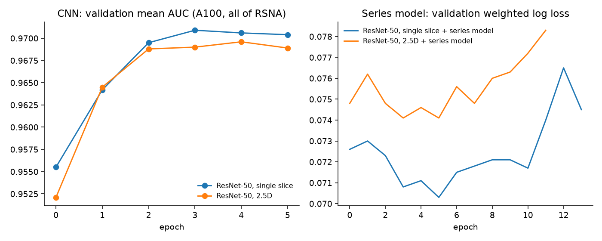
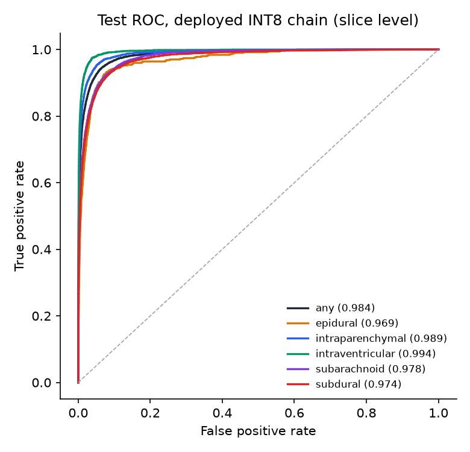
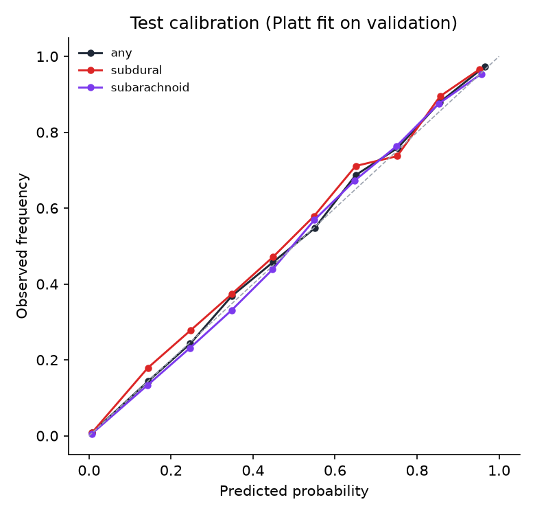
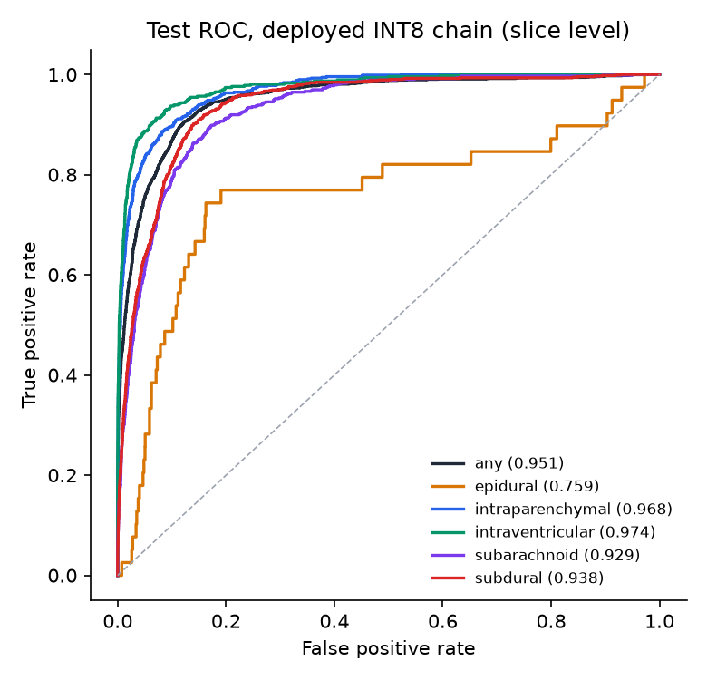
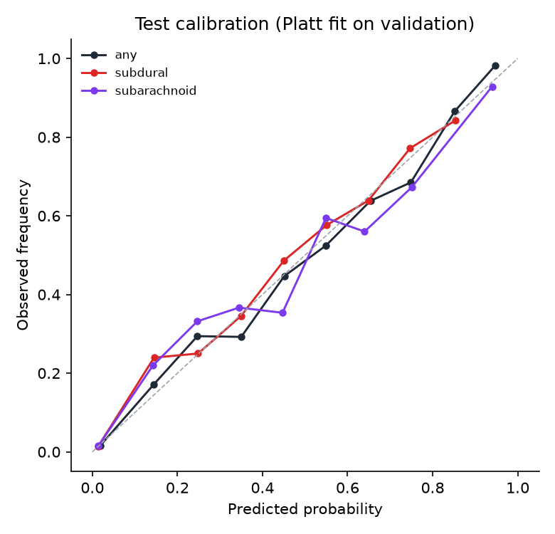

# Results

Every number here was measured in this repository (2026-10-29) on Modal (A100-40GB training,
32-vCPU x86 export), an Apple M4 laptop (10-core CPU, 16 GB), GitHub Actions, and GKE Autopilot
(us-central1). How each number was produced is stated next to it; raw proof is in
[`evidence/`](evidence/README.md).

There are two trained models:

- **Full data (deployed):** ResNet-50 + series model on all of RSNA, trained on Modal. This is
  the bundle the service now ships and the release gates check.
- **Laptop sample:** ResNet-18 on a 9.5% sample, trained on the M4. It produced the first
  ablation and is the bundle the GKE load and monitoring tests below ran on.

## Full data on a cloud GPU (Modal)

`cloud/modal_pipeline.py` runs the same modules as `make data split train seq export benchmark`.
Logs: [`evidence/modal/`](evidence/modal/).

| Stage | Where | Time |
|---|---|---|
| Ingest: whole 144 GB tar → HU cache, 32 range regions | 16 vCPU | 753 s; 21,744 series / 752,802 slices (29 partial series dropped) |
| Split, patient-level 70/15/15, seed 2026 | | 13,256 / 2,841 / 2,841 patients |
| CNN, ResNet-50, 6 epochs, batch 128, bf16, channels-last | A100-40GB | 2D ~1,550–1,640 img/s, 2.5D ~1,380–1,470 img/s; 6 epochs ≈ 11 min of training + ~4 min staging + ~3 min predictions per model |
| Series model, export, INT8, certification, benchmark | 32 vCPU x86 | ~1 h (chain inference on val + test, FP32 and INT8) |

Test set: 2,841 patients, 3,231 series, 111,941 slices (16,050 hemorrhage slices; 1,327
hemorrhage series). 95% CIs resample patients (1,000×); calibration, thresholds and checkpoint
are fit on validation; test is scored once.

### Ablation at full scale

| Model | Macro AUC (95% CI) | Weighted log loss (95% CI) | Study AUC, any (95% CI) | EDH | SAH | SDH |
|---|---|---|---|---|---|---|
| Single-slice CNN (reference project's input) | 0.973 (0.969–0.975) | 0.078 (0.074–0.083) | 0.977 (0.972–0.982) | 0.964 | 0.961 | 0.961 |
| **Single-slice CNN + series model (deployed)** | **0.982 (0.979–0.984)** | **0.065 (0.061–0.070)** | **0.979 (0.974–0.984)** | **0.972** | **0.979** | **0.974** |
| 2.5D CNN | 0.973 (0.969–0.976) | 0.077 (0.073–0.081) | 0.977 (0.972–0.983) | 0.960 | 0.962 | 0.961 |
| 2.5D CNN + series model | 0.979 (0.975–0.982) | 0.068 (0.064–0.072) | 0.978 (0.973–0.984) | 0.964 | 0.975 | 0.973 |

The series model adds +0.009 macro AUC and cuts weighted log loss by 16%, most on
subarachnoid (+0.018) and subdural (+0.013). With 10× the data the CIs no longer overlap: the
2D + series-model CI (0.979–0.984) lies entirely above the single-slice CNN (0.969–0.975).
2.5D input still does not help, and on top of a series model it slightly hurts: the series
model already sees neighbouring slices. The reference project reports a 5-subtype macro AUC
of 0.977 (0.973–0.980) for a single-slice ResNet-50 on all of RSNA; the deployed chain here
scores 0.981 (0.977–0.984) on the same definition, the single-slice CNN 0.972. The test sets
are different patient splits and the CIs overlap, so this is "comparable or slightly better",
not a measured win.

### Deployed chain (INT8 CNN → series model), certified through the serving code

Certified on Modal's x86 CPU; ONNX parity vs PyTorch 2.1e-5. Full report:
[`evidence/full_data_certification.json`](evidence/full_data_certification.json).

"Macro AUC" averages the six labels; "subtype macro" averages the five subtypes, the
reference project's definition.

| Precision | Macro AUC (95% CI) | Subtype macro AUC (95% CI) | Weighted log loss (95% CI) | Study AUC (any) | CNN file |
|---|---|---|---|---|---|
| FP32 ONNX | 0.982 (0.979–0.984) | 0.982 (0.978–0.984) | 0.065 (0.061–0.070) | 0.979 | 94.0 MB |
| **INT8 ONNX, uint8 weights (deployed)** | **0.981 (0.978–0.984)** | **0.981 (0.977–0.984)** | **0.066 (0.062–0.071)** | **0.978 (0.973–0.983)** | **24.1 MB** |
| INT8 single-slice CNN alone | 0.971 (0.967–0.974) | 0.970 (0.966–0.973) | 0.080 | 0.975 | |

Per label, deployed chain, test (slice level, thresholds F1-optimal on validation):

| Label | Positive slices | AUC (95% CI) | AP | ECE | Sensitivity | Specificity |
|---|---|---|---|---|---|---|
| any | 16,050 | 0.984 (0.981–0.986) | 0.927 | 0.002 | 0.847 | 0.978 |
| epidural | 500 | 0.969 (0.951–0.981) | 0.299 | 0.001 | 0.398 | 0.996 |
| intraparenchymal | 5,278 | 0.989 (0.986–0.991) | 0.879 | 0.001 | 0.805 | 0.991 |
| intraventricular | 3,867 | 0.994 (0.993–0.995) | 0.887 | 0.001 | 0.826 | 0.994 |
| subarachnoid | 5,268 | 0.978 (0.973–0.981) | 0.774 | 0.003 | 0.715 | 0.985 |
| subdural | 7,050 | 0.974 (0.968–0.979) | 0.801 | 0.004 | 0.716 | 0.983 |

| Operating point for "any" (chosen on validation) | Level | Sensitivity | Specificity | PPV |
|---|---|---|---|---|
| Screening (≥95% sensitivity on validation) | slice | 0.953 | 0.925 | 0.680 |
| Screening (≥95% sensitivity on validation), the API's `screening_positive` | study | 0.956 | 0.907 | 0.878 |
| F1-optimal, the API's `hemorrhage` | study (max over slices) | 0.923 | 0.947 | 0.925 |

Study-level subtype calls (the API's `subtypes`), thresholds F1-optimal at study level on
validation, test series (3,231):

| Subtype | Positive series | Study AUC | Sensitivity | Specificity | PPV |
|---|---|---|---|---|---|
| epidural | 51 | 0.913 | 0.471 | 0.979 | 0.267 |
| intraparenchymal | 805 | 0.973 | 0.847 | 0.965 | 0.890 |
| intraventricular | 554 | 0.983 | 0.823 | 0.978 | 0.885 |
| subarachnoid | 563 | 0.947 | 0.785 | 0.932 | 0.708 |
| subdural | 555 | 0.952 | 0.807 | 0.933 | 0.715 |

Until the audit these study-level decisions used per-slice thresholds and had never been
scored; they are now fit and certified at the level the API applies them.

 

### Served = certified, across CPU families

- **Startup self-test** on the M4 (ARM) against the x86-certified INT8 golden: max |Δp|
  0.0022 (limit 0.02), so the pod serves INT8. INT8 vs FP32 on the build machine differs by
  0.065 on the phantom, which is why the golden is the certified INT8 output, not FP32.
- **Real held-out series through the API** (`scripts/e2e_real_series.py`; 60 of the 312 cached
  series in the full-data test split, 30 positive, uploaded as shuffled DICOMs): mean |Δp|
  vs certified **0.00026**, max 0.026; study AUC 0.989 through the API vs 0.988 offline on the
  same series ([`evidence/full_data_e2e_real_series_local.json`](evidence/full_data_e2e_real_series_local.json)).
  With `--feedback`, `/v1/performance` reported the same study AUC for "any" from the posted labels
  ([`evidence/full_data_live_performance_local.json`](evidence/full_data_live_performance_local.json)).
- **Release gates** (`tests/regression`, floors macro AUC ≥ 0.97, study AUC ≥ 0.97, weighted log
  loss ≤ 0.075): 5/5 pass.

### Latency (CPU, 4 threads)

[`benchmark_full_resnet50.json`](benchmark_full_resnet50.json) (M4) and
[`evidence/full_data_benchmark_modal_cpu.json`](evidence/full_data_benchmark_modal_cpu.json)
(Modal x86). 32-slice series; the chain runs the CNN in batches of 16, then the series model.

| Engine | M4: 1 slice p50 | M4: 32-slice series p50 / p95 | x86 (Modal): series p50 |
|---|---|---|---|
| PyTorch FP32 | 22.3 ms | 5,792 / 5,914 ms (CNN only) | 1,035 ms (CNN only) |
| ONNX Runtime FP32 | 35.9 ms | 1,836 / 1,842 ms | 707 ms |
| **ONNX Runtime INT8 (uint8 weights)** | **18.7 ms** | **586 / 588 ms** | **499 ms** |

INT8 is 3.1× faster than FP32 ONNX on the M4 and 4× smaller. A series takes 1.8× as long as
with the laptop ResNet-18 bundle (331 ms).

## Laptop sample: ResNet-18 on 9.5% of RSNA

The first model, trained end to end on the M4 (MPS). The GKE results further down used this
bundle.

### Data

| | |
|---|---|
| Source | RSNA 2019 ICH, 16-bit PNG release (`ianpan/rsna-intracranial-hemorrhage-16bit-png@c40c72b`) |
| Sample | 2,065 complete series / 71,736 slices / 1,770 patients (9.5% of RSNA), streamed from 16 tar regions in 141 s |
| Split | patient-level 70/15/15, seed 2026, stratified by rarest subtype |
| Test set | 266 patients, 315 series, 10,934 slices; 1,853 hemorrhage slices, 134 hemorrhage series |
| Test positives (slices) | epidural 39 (5 patients), intraparenchymal 678, intraventricular 460, subarachnoid 621, subdural 904 |

### Ablation: context from 2.5D input vs a series model

Same backbone (ResNet-18, ImageNet init), schedule (5 epochs, balanced sampling), seed and split;
checkpoint chosen on validation; Platt calibration fit on validation; test scored once. 95% CIs
resample patients (1,000×). Training curves: [`evidence/mlflow_training_curves.png`](evidence/mlflow_training_curves.png).

| Model | Macro AUC (95% CI) | Weighted log loss (95% CI) | Study AUC, any (95% CI) | SAH AUC | SDH AUC |
|---|---|---|---|---|---|
| Single-slice CNN (reference project's input) | 0.902 (0.844–0.940) | 0.133 (0.108–0.165) | 0.953 (0.926–0.975) | 0.907 | 0.916 |
| **Single-slice CNN + series model (deployed then)** | **0.920 (0.858–0.956)** | **0.122 (0.097–0.152)** | 0.953 (0.925–0.975) | **0.932** | **0.939** |
| 2.5D CNN | 0.897 (0.841–0.934) | 0.142 (0.114–0.176) | 0.944 (0.915–0.967) | 0.892 | 0.897 |
| 2.5D CNN + series model | 0.915 (0.856–0.951) | 0.128 (0.102–0.159) | 0.946 (0.919–0.968) | 0.917 | 0.936 |

The series model adds ~+0.018 macro AUC to both CNNs, most on subarachnoid (+0.025) and subdural
(+0.023), the reference project's weakest subtypes. 2.5D input did not help at this data scale.
Differences are smaller than the CIs (one seed each); at full scale they are not (above).

### Deployed chain (INT8 CNN → series model), certified through the serving code

`make export`: ONNX (parity vs PyTorch 1.6e-5), static INT8 with uint8 weights, then the
deployed chain runs through `serving.model.InferenceModel` on validation (fit) and test (score).

| Precision | Macro AUC (95% CI) | Weighted log loss | Study AUC (any) | CNN file |
|---|---|---|---|---|
| FP32 ONNX | 0.920 | 0.122 | 0.953 | 44.7 MB |
| **INT8 ONNX, uint8 weights (deployed then)** | **0.920 (0.855–0.957)** | **0.123 (0.099–0.153)** | **0.949 (0.919–0.971)** | **11.3 MB** |
| INT8, int8 weights + reduce_range (rejected; [log](evidence/int8_reduce_range_rejected.log)) | 0.843 | 2.213 | 0.946 | 11.3 MB |

Per label, deployed chain, test (slice level, thresholds F1-optimal on validation):

| Label | Positive slices | AUC (95% CI) | AP | ECE | Sensitivity | Specificity |
|---|---|---|---|---|---|---|
| any | 1,853 | 0.951 (0.936–0.964) | 0.840 | 0.012 | 0.792 | 0.936 |
| epidural | 39 | 0.760 (0.372–0.948) | 0.014 | 0.003 | 0.026 | 0.981 |
| intraparenchymal | 678 | 0.967 (0.954–0.978) | 0.781 | 0.005 | 0.652 | 0.986 |
| intraventricular | 460 | 0.974 (0.962–0.986) | 0.784 | 0.006 | 0.691 | 0.987 |
| subarachnoid | 621 | 0.931 (0.903–0.957) | 0.514 | 0.011 | 0.498 | 0.970 |
| subdural | 904 | 0.939 (0.917–0.960) | 0.614 | 0.010 | 0.629 | 0.952 |

| Operating point for "any" (chosen on validation) | Level | Sensitivity | Specificity | PPV |
|---|---|---|---|---|
| Screening (≥95% sensitivity on validation) | slice | 0.972 | 0.683 | 0.385 |
| F1-optimal | study (max over slices) | 0.940 | 0.790 | 0.768 |

 

### Latency (CPU, 4 threads, Apple M4)

`make benchmark` → [`benchmark.json`](benchmark.json). 32-slice series; the chain runs the CNN
in batches of 16, then the series model.

| Engine | 1 slice p50 / p95 | 32-slice series p50 / p95 |
|---|---|---|
| PyTorch FP32 | 11.7 / 12.2 ms | 1,027 / 1,111 ms (CNN only) |
| ONNX Runtime FP32 | 12.8 / 13.0 ms | 675 / 712 ms |
| **ONNX Runtime INT8 (uint8 weights)** | **8.2 / 8.6 ms** | **331 / 399 ms** |

INT8 is 2.0× faster than FP32 ONNX and 3.1× faster than PyTorch per series. The first INT8
build (int8 weights) was faster on ARM (257 ms; console output, not kept) but numerically wrong on x86 without VNNI (see
the incident below); uint8 weights trade ~30% ARM speed for identical behaviour on every CPU.

## Kubernetes, local (kind on a 4-vCPU Colima VM)

- **Serving = evaluation:** 60 real held-out series uploaded as shuffled DICOMs through the
  Service matched the offline certified probabilities within **5.0e-6** (same CPU family;
  console output, not kept).
- **Autoscaling** (in-cluster Job, 32-slice series): HPA 1 → 3 pods in 31 s; 2.17 → 3.12
  series/s; 0 errors up to 8 clients. Ceiling = the VM's 4 vCPUs
  ([`evidence/kind_load_steps.md`](evidence/kind_load_steps.md)).

## Kubernetes, cloud (GKE Autopilot via Terraform, AMD EPYC 7B13 nodes; ResNet-18 bundle)

Provisioned with `infra/terraform` (13 resources: Autopilot cluster with Dataplane V2, Artifact
Registry with cleanup policy, least-privilege node service account; cluster ready in 6 min 52 s),
image built on amd64 by Cloud Build, deployed with the same Helm chart, then destroyed.

**Correctness on the cloud CPU.** 60 real held-out series through the GKE Service: mean
|Δp| vs certified **0.0009**, max 0.027; study AUC 0.920 (offline, same series: 0.922). The first
deployment did *not* pass this check (max |Δp| 0.56): see the incident below.

**Autoscaling under in-cluster load** (Job, 32-slice synthetic series, 90 s steps, last 60 s measured):

| Concurrent clients | Series/s | p50 ms | p95 ms | Errors | Ready pods |
|---|---|---|---|---|---|
| 1 | 1.42 | 701 | 813 | 0 | 1 → 2 |
| 2 | 2.00 | 797 | 2,002 | 0 | 2 → 3 |
| 4 | 2.52 | 1,273 | 3,566 | 0 | 3 |
| 8 | 2.57 | 1,406 | 8,528 | 0 | 3 (HPA wants 4) |
| 12 | 3.08 | 2,086 | 10,609 | 0 | 3 (HPA wants 4) |
| 16 | 2.65 | 1,487 | 16,448 | 0 | 3 (HPA wants 4) |

HPA asked for a 2nd and 3rd pod within 50 s (ready by 150 s) and for a 4th at ~266 s; Autopilot
was still adding capacity for it when the test ended at 562 s, so the 12- and 16-client steps
ran on 3 pods (the timeline never shows a 4th ready pod). One 2-vCPU EPYC pod serves ~1.4 series/s (slower than
the M4). Past ~3 series/s the extra clients only queue: p95 grows, nothing fails. Timeline:
[`evidence/gke/hpa_timeline.txt`](evidence/gke/hpa_timeline.txt).

**Monitoring and alerting, live.** Grafana under load:
[`evidence/gke/grafana_dashboard_under_load.png`](evidence/gke/grafana_dashboard_under_load.png).
The synthetic load images are not real CT; drift PSI rose to 3–12 on every feature and
`BrainCTInputDrift` fired; p95 above 5 s at 16 clients fired `BrainCTHighLatency`; both reached
Alertmanager (6 alert instances). `BrainCTLiveQualityDrop` stayed inactive.

**Live model quality from delayed ground truth.** For 80 real series the true study labels were
posted to `/v1/feedback`; the service's live study AUC for "any" was **0.959** (40 positive),
equal to the offline AUC of the same series
([`evidence/gke/live_performance_feedback.json`](evidence/gke/live_performance_feedback.json)).
Study-level ECE was 0.08–0.12 (ResNet-18 bundle): calibration is fit per slice, and the max
over a series is not re-calibrated (see limitations).

## Multi-GPU training path

`torchrun --nproc_per_node 2` with the gloo backend on CPU: both ranks trained their shard
(8 steps each), rank 0 validated, checkpointed and wrote predictions
([`evidence/ddp_gloo_2proc.log`](evidence/ddp_gloo_2proc.log)). On CUDA the same code uses NCCL.

## CI (GitHub Actions, every push)

Actions pinned by commit SHA. Lint, format, mypy, the service-side tests with an 85% coverage
gate (94% measured; 107 tests locally including PyTorch and trained-bundle release tests),
lockfile/requirements drift check; image build (base pinned by digest), Trivy (fixable HIGH
and CRITICAL fail the build), no-PyTorch and non-root assertions, read-only-root smoke test;
kind + Helm end-to-end on that same scanned image: a series through the Service, a rolling
restart under in-cluster traffic (any non-200 fails), `promtool` / `amtool` checks, and
Prometheus scraping the pods with the rules loaded; Terraform fmt/validate/tflint.
